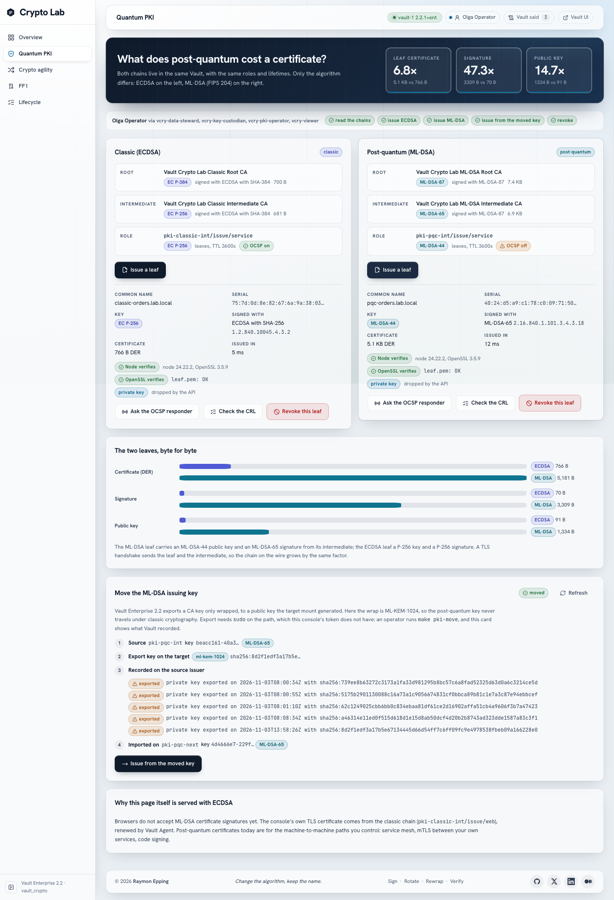

# vault_crypto

Vault Enterprise 2.2 brought post-quantum certificates, Transit keys that change
algorithm under the same name, and FF1 format-preserving encryption. This lab
runs a Vault Enterprise 2.2.1 node on Podman and shows each feature in a small
web console, with Vault's own answers next to every result.



## The four rooms

| Room | Vault 2.2 feature | What you see |
| --- | --- | --- |
| Quantum PKI | ML-DSA keys in the PKI engine; CA key export wrapped under ML-KEM (Enterprise) | A classic ECDSA chain and an ML-DSA chain side by side. Issue a leaf from each: the ML-DSA leaf is about 6.7 times larger, its signature about 46 times. Both verify in Node and in OpenSSL 3.5. OCSP answers for the classic chain only; the ML-DSA chain publishes revocation in an ML-DSA-signed CRL. `make pki-move` moves the ML-DSA issuing key to another mount, wrapped. |
| Crypto agility | `POST transit/keys/:name/algorithm` (Enterprise) | `orders-signing` goes from `ecdsa-p256` to `ml-dsa` to `hybrid`. Every older signature keeps verifying, and the caller still calls `transit/sign/orders-signing`. Vault refuses a change from signing to encryption, and the page shows its reason. |
| FF1 | Transform: FF1 for new FPE transformations, `transform/rewrap` (Enterprise, ADP) | Synthetic card numbers, Dutch IBANs and BSNs keep their shape when encoded. One batch call moves the cards from one transformation to another without returning plaintext. |
| Lifecycle | One inventory across classic and post-quantum issuers | Every certificate the lab issued, by algorithm and status, revocation, CRL freshness, and links into Vault's own UI. |

Every call the rooms make was first run against the live node by `make probe`;
[docs/capabilities.md](docs/capabilities.md) has what Vault 2.2.1 answered.

## Quickstart

Needs Podman 5+ (machine with 4 GB or more), `vault`, `terraform`, `jq`,
`openssl` and `curl` on the host, and a Vault Enterprise licence.

```bash
make env-init               # creates .env; put the licence in VAULT_LICENSE
make license                # installs it to .secrets/vault/vault.hclic
make bootstrap              # from zero to verified
open https://localhost:13501/
```

The console's certificate comes from Vault (`pki-classic-int`). `make trust-root`
adds the lab's classic root to the macOS keychain so the browser accepts it.

**Sign in** (top right) as one of five fictional people. Their passwords live
in Vault KV and are never printed: `make identity-copy-password U=olga` puts
one on the clipboard. `olga` may do everything; `vera` only reads, and Vault
refuses the rest. Vault itself decides: the console runs every action on a
Vault token issued to you. The Vault UI accepts the same people through LDAP.

Daily: `make up` and `make down`. After the Mac slept: `make clock-sync`.
`make help` lists everything.

## Ports (127.0.0.1 only)

| Port | Service |
| --- | --- |
| 13501 | Console (HTTPS) |
| 13500 | API |
| 13502 | Keycloak (realm `vcry`) |
| 18801 | vault-1 (Enterprise 2.2.1) |
| 18800 | vault-s (Community 2.2.1, the seal Vault) |

Override any of them in `.env`.

## Checks

| Command | What it proves |
| --- | --- |
| `make verify` | Vault, both chains, demo keys, machine and human identities, the API's denied paths, web TLS, a round trip through each room |
| `make identity-verify` | Every persona: Keycloak groups, Vault policies over JWT and LDAP, allowed and refused actions |
| `make api-test` | Every API route against the live stack |
| `make test-unit` | API logic without a stack |
| `make test-ui` | Playwright journeys for every room, axe WCAG 2.1 AA at desktop and phone size |
| `make rotation-test` | Breaks credentials on purpose; every case heals |
| `make tf-plan-all` | Terraform matches Vault, also after a demo |
| `make doctor` | Names what is wrong and the command that fixes it |
| `make lint` | shellcheck, `terraform fmt` and `validate` (also in GitHub Actions, with the unit tests and the console build) |
| `make bench` | Vault requests and latency per API call (`docs/optimization.md`) |

`make demo-reset` puts every room back to its starting state.

## Public CA integration (not shown yet)

Vault 2.2 can also act as an ACME client of a public CA (PKI External CA
secrets engine). `make publicca-up && make publicca-probe` runs it against a
local Pebble. On 2.2.1 Pebble validates the challenge and issues the
certificate, but Vault's order ends in an error at finalize
([docs/publicca-probe.md](docs/publicca-probe.md)), so the console has no panel
for it yet.

## What this lab does not do

It shows Vault 2.2's features honestly, on one laptop. A production
deployment differs in at least these ways:

- Both root CAs are online, in the same Vault as their intermediates. In
  production a root stays offline, or at least in a separate cluster.
- vault-s uses one Shamir key share, and each Vault is a single Raft node.
  Production uses several key holders or an HSM or cloud KMS seal, and three or
  five nodes.
- Host scripts (Terraform, bootstrap, probe, demo-seed, `make pki-move`) use
  the root tokens from `.secrets/`. Production revokes root tokens and gives
  each tool its own auth method.
- Keycloak runs in `start-dev` mode over plain HTTP on localhost, and the
  `vcry-cli` client allows password grants so scripts can test as each persona.
  Production runs Keycloak with TLS, a database and no password grant.
- Console sessions and the demo history (signatures, ledger entries) live in
  the API's memory: an API restart signs everyone out and empties both.
- The five personas and their passwords are generated for the lab.
- There is one audit file device per Vault node. Production sends audit logs to
  two devices and a SIEM.

## Read more

- [docs/rooms.md](docs/rooms.md): each room, its API calls and what to say while demoing
- [docs/architecture.md](docs/architecture.md): containers, Terraform, the seal plane
- [docs/security-model.md](docs/security-model.md): people and machines, who may do what
- [docs/operations.md](docs/operations.md): start, stop, reset, recover, back up
- [DESIGN.md](DESIGN.md): the console's design rules
